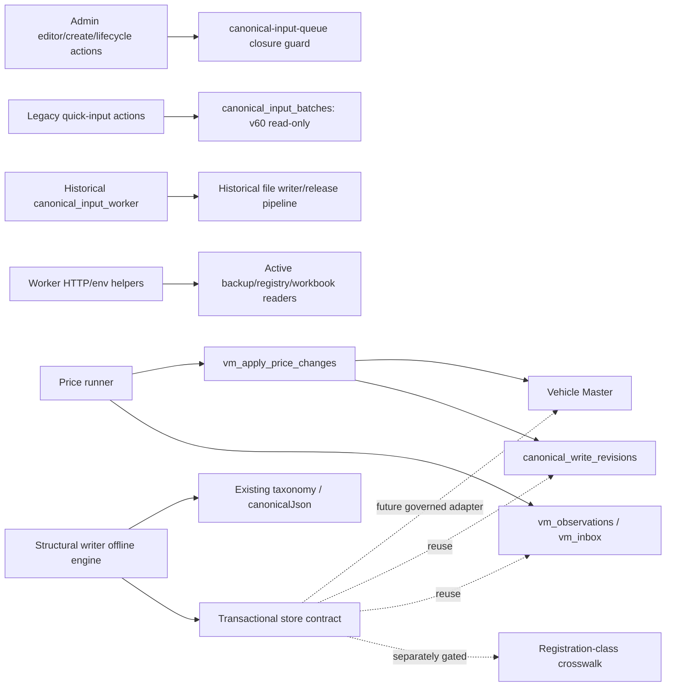

# Structural Identity Writer — legacy audit (Issue #236)

Audit baseline: PR #235 `b5a6bcff2870afb8d81d672dd284e7935e3cb4ac`; main `c2715cbee494ae076b2582ef99f2bbc590b5dd99`. Portfolio roadmap v1.0 (approval source `42be6b6a803727086b404b2cb46f75593bb2c1d4`), Vehicle DB v3 §3–5/§12, and migration v60 govern this bounded offline implementation. Domain: Vehicle Master structure, with a separately gated Ice link operation. The uploaded owner task is the authorization; Issue #236 and PR #235 API discussion reads return HTTP 403 in this environment. No live database schema inspection or write was performed. Repository DDL and the frozen SELECT-only catalog snapshot are the available schema/data evidence.

## Inventory and decision

| Component | Classification | Callers / evidence | Decision |
| --- | --- | --- | --- |
| `vehicle_brands`, `vehicle_models`, identity revisions / FK and immutable-ID rules (v57/v59) | ACTIVE — REUSE | `current_*` serving views, admin readers, v66 price band updates | Use the same master. Basic-model schema gaps below prevent a production adapter. |
| `lib/vehicle-engine/{taxonomy,specs}.ts` | ACTIVE — REUSE | Engine parity checks, entity/fact validation | Reuse canonical vocabulary and stable value serialization; do not reuse trim normalization for model identity. |
| `lib/ice-scoped-crosswalk.ts` | ACTIVE — REUSE (offline) | R6 scoped-reader acceptance tests; no live cutover | Reuse exact registration-class normalization, reject ALL on writes. |
| `vm_observations`, immutable trigger (v66) | ACTIVE — REUSE / schema extension required | `lib/price-refresh/store.ts` | Extend the existing evidence sink for structural field keys after C02; never alter the price meaning. |
| `vm_inbox`, `vm_inbox_propose` (v66) | ACTIVE — REUSE | Price runner STRUCTURE/PRICE_JUMP/SOURCE_BROKEN proposal flow | Reuse STRUCTURE proposals and dedupe/suppression semantics; no second inbox. |
| `canonical_write_revisions` (v12 + v66) | ACTIVE — REUSE | Price apply/revert SQL, price runner history | Reuse catalog topic, before/after payload/hash, actor, revisions, batch_id, reverts_id. |
| `vm_apply_price_changes`, `lib/vehicle-engine/price-writer.ts`, `lib/price-refresh/store.ts` | ACTIVE — REUSE (audit/context conventions only) | Price refresh workflow and tests | Keep unchanged. Price-only RPC cannot create structure or Ice links. |
| `lib/admin-auth.ts` | ACTIVE — REUSE (future server adapter) | Current admin server actions | Verify session on server; never trust an actor kind or approval in request JSON. Shared-password display names are not verified individual identities. |
| `canonical_input_batches`, `canonical_write_commands`, object map, projections/outbox/releases | RETIRED — PRESERVE FOR HISTORY | Admin history readers; v60 SELECT-only grants and closure RPCs | No database deletion, write or reactivation. Commands cannot be reused as new structural intake. |
| `lib/canonical-input-queue.ts` and enqueue/publish workflows | RETIRED — PRESERVE FOR HISTORY | Editor, create, lifecycle, trim actions import the throwing compatibility function; workflows are closure stubs | Keep guards and exported signatures. |
| `vehreg/canonical_write.py`, `canonical_queue.py`, `input_pipeline.py`, `tools/canonical_write.py` | RETIRED — PRESERVE FOR HISTORY | Historical pipeline and extensive regression/parity tests; corpus generator calls the file writer on temporary copies | Not dead: do not delete or use for DB structure. |
| `tools/canonical_input_worker.py` | RETIRED — PRESERVE FOR HISTORY (worker); ACTIVE — REUSE (shared HTTP/env helpers) | Backup, external identity sync, workbook workers import helpers; legacy workflow is closed | Do not remove this module or import it into the structural writer. |
| `app/admin/input-actions.ts` private legacy enqueue/dispatch helpers | UNCERTAIN — HOLD FOR REVIEW | Exported quick-input server actions still call these helpers; v60 rejects DB mutation | Leave intact in this PR. Runtime callers exist, so deleting these would exceed proven-unused cleanup. Do not connect them to the new writer implicitly. |
| Legacy operational CLI tools (enqueue/requeue/import/bootstrap/ECO/pricefeed) | RETIRED — PRESERVE FOR HISTORY / UNCERTAIN — HOLD FOR REVIEW | Historical callers/tests and command-line entrypoints; external invocation cannot be disproved | No blanket deletion. Production closure is v60; offline historical fixtures remain supported. |
| `lib/canonical-write-shadow.ts` internal crypto/DB enqueue implementation | DEAD CODE — SAFE TO REMOVE | Repository-wide search finds no runtime import/caller of module or exported function; only historical docs | Remove unused database-writing implementation in a separate commit. Preserve exported types/function as a no-write `disabled` compatibility guard. |
| `ice_model_crosswalk`, legacy RPCs (v63) | ACTIVE — REUSE (history only for this task) | Current group-level readers/matcher | No registration-class key or revision column; cannot store scoped writes safely. Never send scoped links to group RPC. |
| PR #232 scoped design / PR #235 frozen manifests | ACTIVE — REUSE (offline evidence) | R6 v2 replay and manifest tools/tests | Preserve all 244 decisions and full M7 totals. Scoped DB integration remains independently blocked. |

## Dependency graph

## Reuse and database gaps

The missing component is a bounded structural planner and atomic executor under the existing Vehicle Engine boundary. It targets existing master/evidence/audit conventions through a transactional store contract. Only a fake in-memory adapter is shipped for tests; there is no network/database adapter or production route.

Production needs a reviewed, unnumbered schema/RPC design first: v59 `_vm_model_problems` requires body/cab/registration facts and `_vm_structure_conflicts` requires generations/variants; basic identity must not fabricate them. v57 requires seed lineage and served dates, and status cannot represent UNKNOWN. v66 observations only allow price/trim-listing field keys. v63 is group-only. These are explicit integration blockers, not reasons to relax current production constraints or pretend fake-store success proves database acceptance.

Cleanup is limited to the unused shadow bridge implementation. The Python writer/worker and all database objects, RPCs, triggers, data, logs and backups stay intact. `structural-writer/legacy_writer_dependencies.json` records repository-wide matches and source hashes for reproducibility.
